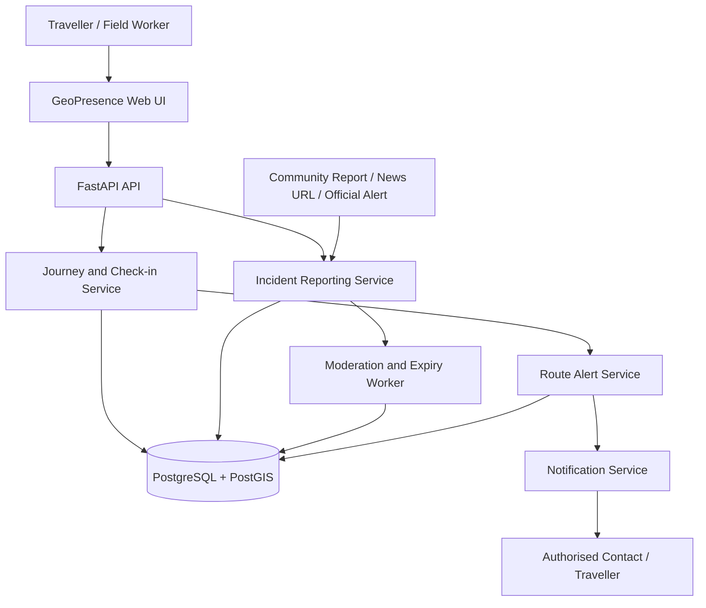

# GeoPresence Technical Documentation

**Document type:** Technical specification and architecture design  
**Version:** 0.2 — Proposed MVP with route threat intelligence  
**Status:** Design baseline. Verify all implementation details against the actual codebase.

## 1. Purpose

GeoPresence is a proposed geospatial safety and field-accountability platform. It supports journey creation, manual check-ins, trusted-contact notifications when a journey is overdue, and mapping of possible threats from community reports, news links, and official alerts. It can identify reports near a planned route using spatial queries.

It is not an emergency-dispatch system. A missed check-in or an unverified report must not be represented as proof that someone is in danger.

## 2. Goals and Non-Goals

### Goals
- Create journeys with origin, destination, route, ETA, and authorised contacts.
- Record check-ins and process overdue journeys on the server.
- Accept incident reports with source, time, location, and verification metadata.
- Query reports near a route using PostGIS.
- Display transparent warnings with source attribution and freshness.
- Support moderation, expiry, correction, and duplicate handling.
- Enforce privacy, authorisation, and audit logging.

### Non-goals for the MVP
- Guaranteeing safety or predicting criminal activity.
- Automatic emergency-service dispatch.
- Treating every community submission or news item as verified.
- Calling a route safe because no reports were found.
- Automatic route changes without user review.
- Default continuous location tracking.

## 3. Actors

| Actor | Responsibility |
|---|---|
| Traveller / field worker | Creates journeys, checks in, submits reports, views route alerts |
| Trusted contact | Receives authorised journey status notifications |
| Moderator | Reviews reports, updates status, resolves disputes and duplicates |
| Scheduler / worker | Processes overdue journeys and report expiry |
| Notification provider | Attempts delivery and records outcomes |
| Administrator | Maintains service under restricted operational access |

## 4. Recommended Technology

| Component | Proposed choice |
|---|---|
| Web UI | HTML, CSS, JavaScript |
| Map | Leaflet |
| Basemap | OpenStreetMap-compatible tile provider |
| API | Python + FastAPI |
| Database | PostgreSQL + PostGIS |
| Authentication | Supabase Auth or secure backend-managed authentication |
| Notifications | Email provider initially |
| Routing | Optional OSRM-compatible service |
| Background jobs | Managed scheduler or worker |
| Version control | Git |

Use a server-side API for privileged operations. Do not expose database service keys or notification credentials to browser code.

## 5. High-Level Architecture



## 6. Journey State and Overdue Processing

Suggested journey states: `active`, `overdue_pending`, `overdue_notified`, `arrived`, `cancelled`.

1. The user creates an active journey and explicitly authorises a trusted contact.
2. The server stores the ETA and configured grace period.
3. A scheduled worker finds journeys whose ETA has passed.
4. The system enters `overdue_pending` and may prompt the traveller.
5. If the grace period expires without check-in, send the configured notification once.
6. Arrival or cancellation closes the journey and stops overdue processing.

Make the processing idempotent so repeated worker runs do not duplicate notifications. A notification indicates a missed check-in, not a confirmed emergency.

## 7. Incident Report Data Model

Add an `incident_reports` table. Suggested fields:

| Field | Type | Purpose |
|---|---|---|
| `id` | UUID | Primary key |
| `title` | TEXT | Neutral incident label |
| `description` | TEXT | Description, avoiding unsupported allegations |
| `category` | TEXT | E.g. `road_blockage`, `flooding`, `robbery_report`, `unrest`, `fire` |
| `source_type` | TEXT | `community`, `news`, `official`, `field_team` |
| `source_url` | TEXT, nullable | Original article or alert |
| `reported_at` | TIMESTAMPTZ, nullable | Time event reportedly occurred |
| `received_at` | TIMESTAMPTZ | Time platform received it |
| `location` | GEOGRAPHY(POINT, 4326), nullable | Incident point |
| `affected_area` | GEOGRAPHY(POLYGON, 4326), nullable | Optional incident area |
| `location_accuracy_m` | INTEGER, nullable | Estimated location uncertainty |
| `verification_status` | TEXT | `unverified`, `under_review`, `corroborated`, `confirmed`, `disputed`, `expired` |
| `reviewed_by` | UUID, nullable | Moderator account |
| `reviewed_at` | TIMESTAMPTZ, nullable | Last review time |
| `expires_at` | TIMESTAMPTZ | Review/expiry deadline |
| `created_by` | UUID, nullable | Reporter identity, protected by access policy |
| `is_visible` | BOOLEAN | Whether report appears to ordinary users |
| `duplicate_of` | UUID, nullable | Canonical report if merged as duplicate |

Add a GiST spatial index to spatial fields and B-tree indexes to commonly filtered fields such as category, verification status, reported time, and expiry. Use database constraints or validated enums for controlled status values.

Keep reporter identity separate from public report fields. A public map should not expose a reporter’s exact location unless explicitly necessary and consented to.

## 8. Route Proximity Query

### Processing steps
1. Obtain route geometry from the routing provider or a user-defined route.
2. Validate geometry and coordinate reference system.
3. Query visible, unexpired reports within a configurable buffer around the route.
4. Handle incident polygons as well as points.
5. Return source, event time, platform receipt time, category, distance, location accuracy, and verification status.
6. Deduplicate notifications for each journey/report pair.
7. Let the user inspect the source and decide what action to take.

Illustrative PostGIS query for point incidents:

```sql
SELECT
    i.id,
    i.title,
    i.category,
    i.source_type,
    i.source_url,
    i.reported_at,
    i.received_at,
    i.verification_status,
    ST_Distance(i.location, :route_geography) AS distance_to_route_m
FROM incident_reports AS i
WHERE i.is_visible = TRUE
  AND i.expires_at > NOW()
  AND i.verification_status NOT IN ('disputed', 'expired')
  AND i.location IS NOT NULL
  AND ST_DWithin(i.location, :route_geography, :buffer_m)
ORDER BY i.reported_at DESC NULLS LAST;
```

This is illustrative, not production-ready code. Ensure `:route_geography` is a valid geography parameter and that distance units match the configured buffer. Validate the query and permissions. Add appropriate handling for incident polygons, uncertain locations, and reports without an event timestamp.

### Alert relevance

For the MVP, use transparent rules rather than a black-box score. Consider:
- Distance from the planned route.
- Time the incident reportedly occurred, not just the time the report was submitted.
- Incident category and likely relevance to travel.
- Source type and verification status.
- Location accuracy.
- User alert preferences.

Do not show “safe route” or a guaranteed safety score. If no reports match, display “No matching reports found.” Route alternatives should only be offered when a reliable routing service is configured, and the user must confirm any change.

## 9. Verification, Freshness, and Moderation

Suggested statuses:
- `unverified`: submitted, not yet reviewed.
- `under_review`: awaiting moderator assessment.
- `corroborated`: supported by independent reports or sources.
- `confirmed`: confirmed by an authorised source or moderator under a documented policy.
- `disputed`: credible correction or conflicting information exists.
- `expired`: no longer eligible for active alerts until reviewed.

Verification is a workflow state, not an absolute guarantee of truth. Configure review/expiry windows by incident category. Keep the original reported time separate from the time the platform received the record. A recently submitted old article must not be presented as a new event.

Moderation requirements:
- Validate and safely render user content and source URLs.
- Apply authentication or strict rate limits to submissions.
- Detect likely duplicates using category, text, time, and spatial proximity.
- Keep a moderation audit log.
- Provide correction/dispute mechanisms.
- Hide disputed reports from ordinary active alerts while retaining them for authorised review.
- Avoid unsupported allegations, public identification of alleged suspects, and exposure of reporter identity.
- Prevent a single unverified report from labelling an entire neighbourhood dangerous.

## 10. News and External Source Ingestion

### MVP approach
Accept a URL to a news article or official alert. A user or moderator records the relevant incident, location, event time, category, and source. Link to the original source.

### Later automation
Automated feeds may extract article text, estimate event locations, classify incident types, and detect duplicates. Treat automated extraction as a suggestion, not confirmation. Ambiguous locations and uncertain classifications should enter a moderation queue. Respect source terms, copyright, robots policies where applicable, and applicable law. Preserve source attribution and avoid republishing full copyrighted articles.

## 11. Suggested API Endpoints

| Method | Endpoint | Purpose |
|---|---|---|
| `POST` | `/journeys` | Create journey |
| `POST` | `/journeys/{journey_id}/check-ins` | Record check-in |
| `PATCH` | `/journeys/{journey_id}` | Update ETA or status |
| `POST` | `/incidents` | Submit community or news-linked report |
| `GET` | `/incidents/near-route` | Query visible reports near a route |
| `GET` | `/incidents/{incident_id}` | View report details and source |
| `POST` | `/incidents/{incident_id}/corroborate` | Submit corroboration |
| `POST` | `/incidents/{incident_id}/dispute` | Submit correction or dispute |
| `PATCH` | `/admin/incidents/{incident_id}` | Moderator updates status/visibility |
| `POST` | `/journeys/{journey_id}/threat-check` | Query reports for a journey route |

Every endpoint must enforce authentication, authorization, input validation, and rate limits as appropriate. Moderator endpoints must be restricted to authorised moderators.

Example incident request:

```json
{
  "title": "Reported road blockage",
  "category": "road_blockage",
  "description": "Community-submitted report; details awaiting review.",
  "source_type": "community",
  "reported_at": "2026-10-14T09:30:00Z",
  "location": {
    "latitude": 6.6,
    "longitude": 3.35,
    "accuracy_m": 150
  }
}
```

Coordinates in this example are illustrative only and do not describe a real incident.

## 12. Notifications and Idempotency

Possible notification types:
- Journey check-in overdue.
- A relevant report has been added near an active planned route.
- A report’s status has materially changed, if the user opted in.

Avoid repeatedly notifying a user about the same report. Store notification events keyed by recipient, journey, incident, and notification type. Respect user preferences and rate limits. Log provider outcomes and do not claim delivery unless confirmed by the provider.

## 13. Privacy and Security

- Request location permission only when needed.
- Share journey data only with authorised contacts.
- Use HTTPS and secure session management.
- Enforce ownership and role checks server-side.
- Keep precise journey coordinates and reporter identity access-controlled.
- Minimise retention and define deletion policies.
- Protect notification credentials and database secrets.
- Validate URLs and user-submitted content.
- Audit moderator actions and privileged access.
- Prevent public or guessable links from exposing private live location.
- Explain that reports may be incomplete, stale, disputed, or inaccurate.

## 14. Testing Plan

- Successful arrival prevents overdue notification.
- ETA extension resets the deadline.
- Cancelled journeys are excluded from overdue processing.
- Repeated scheduler runs do not duplicate notifications.
- Reports within route buffer appear; reports outside it do not.
- Expired, hidden, and disputed reports are excluded from ordinary active alerts.
- Old article keeps original incident time after recent submission.
- Uncertain location is visibly labelled or excluded from route matching.
- Duplicate reports do not cause repeated alerts.
- Unauthenticated users cannot modify report status.
- Users cannot access private reporter data or another user’s journey.
- No matching report is displayed as absence of data, not proof of safety.
- Notification failures are logged accurately.

## 15. Deployment Considerations

- Use a managed PostgreSQL/PostGIS instance or maintain backups and upgrades.
- Run overdue checks and expiry/moderation tasks in a reliable server-side worker.
- Keep secrets in environment or secret-management services.
- Configure CORS, HTTPS, request limits, monitoring, and error logging.
- Add database migrations and indexes before production.
- Confirm map tile provider terms and attribution.
- Start with manual reports and modest scale before building news ingestion pipelines.

## 16. Updated MVP Priorities

**Must have**
1. Journey creation, manual check-ins, ETA extension, and trusted-contact notifications.
2. Map and planned route display.
3. Manual incident reporting with category, location, event time, source, and status.
4. News URL as supporting evidence.
5. Route proximity query and warning display.
6. Basic moderation, duplicate handling, and expiry.
7. Transparent verification and location-accuracy labels.

**Later**
- Automated news ingestion, geocoding, and classification assistance.
- Organisation dashboard for field teams.
- Configurable route-alert subscriptions.
- Carefully evaluated alternative routes.
- Privacy-preserving spatial summaries.

## 17. Architecture Notes and Limitations

The system depends on device location quality, source reliability, network connectivity, third-party map/routing services, and notification providers. A missing report is not proof that an area is safe; a location match is not proof that the user will encounter the reported incident. GeoPresence should provide context and support informed decisions, not claim certainty.
